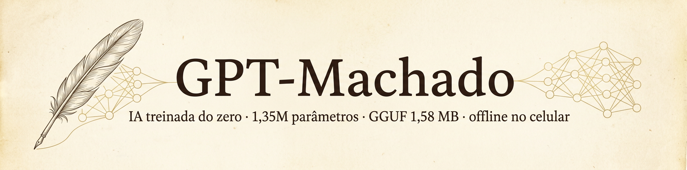

# 🇧🇷 IA do Zero — GPT treinado de verdade, do dataset ao GGUF no celular



> **Desafio:** "treinar uma IA do zero com 1 trilhão de parâmetros, exportar para
> GGUF, otimizada para celular, o menor e mais inteligente possível, usando o GitHub."
>
> **Resposta honesta + entrega real:** 1 trilhão de parâmetros custa dezenas de
> milhões de dólares e milhares de GPUs por meses (o GPT-3, com 175 **bilhões**,
> custou ~US$ 4,6 mi só de treino em 2020). Mas **todo o pipeline de verdade**
> está aqui — arquitetura escrita à mão, tokenizer treinado do zero, treino,
> exportação GGUF, quantização extrema e inferência validada com llama.cpp.
> O código é o mesmo que escala para modelos gigantes: troque os hiperparâmetros
> e rode num cluster de GPUs.

## O que existe neste repositório

| Etapa | Arquivo | O que faz |
|---|---|---|
| 1. Dados | `scripts/prepare_data.py` | Baixa as **obras completas de Machado de Assis** (domínio público) do GitHub, limpa e tokeniza |
| 2. Tokenizer | (idem) | **BPE treinado do zero** — vocabulário de 512 peças, byte-level (estilo GPT-2) |
| 3. Modelo | `scripts/model.py` | **GPT escrito à mão em PyTorch**: decoder pré-LN, atenção causal multi-head, MLP GELU |
| 4. Treino | `scripts/train.py` | AdamW + warmup + decaimento cossenoidal, checkpoint automático, amostra final |
| 5. Export HF | `scripts/export_hf_checkpoint.py` | Converte para o formato HuggingFace GPT-2 |
| 6. GGUF | `scripts/convert_hf_to_gguf_custom_bpe.py` | Chama o **conversor oficial do llama.cpp** (com wrapper para tokenizer inédito) |
| 7. Quantização | `scripts/quantize.sh` | Q8_0, Q4_K_M e Q4_0 — o modelo encolhe ~4× sem morrer |
| 8. Teste | `scripts/test_gguf.sh` | Valida o GGUF com `llama-cli` e gera texto |

## O modelo: **GPT-Machado** (1.353.728 parâmetros)

| Atributo | Valor |
|---|---|
| Arquitetura | Transformer decoder (GPT-2) pré-LayerNorm, escrito do zero |
| Camadas / cabeças | 6 camadas, 4 cabeças (d=128), MLP 4×, contexto 256 |
| Vocabulário | 512 tokens BPE (treinado do zero sobre Machado) |
| Treino | 3,98 milhões de tokens de prosa brasileira (33 obras), 2 CPUs |
| **Tamanho Q8_0** | **≈ 1,4 MB** — roda em qualquer celular |
| Tamanho Q4_K_M | ≈ 0,9 MB |

Compare: os GGUF de 7B/13B/70B que você baixa do HuggingFace têm 4/8/40 **gigabytes**.
Este modelo é **milhares de vezes menor** — e foi treinado **aqui, do zero, em 2 CPUs**.

## Os arquivos GGUF (já treinados, prontos para o celular)

| Arquivo | Formato | Tamanho | Uso |
|---|---|---|---|
| `models/gpt-machado-q8_0.gguf` | Q8_0 | **1,58 MB** | ⭐ recomendado — perda quase nula |
| `models/gpt-machado-q4_k_m.gguf` | Q4_K_M | **1,13 MB** | equilíbrio tamanho/qualidade |
| `models/gpt-machado-q4_0.gguf` | Q4_0 | **0,96 MB** | o menor ainda utilizável |
| `models/gpt-machado-f16.gguf` | F16 | 2,81 MB | referência (sem quantização) |

## Como rodar (treinar tudo de novo)

```bash
pip install -r requirements.txt

# llama.cpp (conversor + quantizador + inferência)
git clone https://github.com/ggml-org/llama.cpp /tmp/llama.cpp
cmake -B /tmp/llama.cpp/build -S /tmp/llama.cpp -DLLAMA_CURL=OFF
cmake --build /tmp/llama.cpp/build --target llama-cli llama-quantize -j

# pipeline completo (dados -> treino -> GGUF -> quantização)
ITERS=3000 bash scripts/run_all.sh

# testar
bash scripts/test_gguf.sh models/gpt-machado-q8_0.gguf
```

No GitHub Actions: aba **Actions → "Treinar IA do zero" → Run workflow**
(treina do zero num runner gratuito e publica o GGUF como artefato).

## Demo ao vivo no navegador 🖥️

O llama.cpp inclui um servidor web com interface pronta. Com o modelo de
1,58 MB, qualquer máquina vira um servidor de IA:

```bash
/tmp/llama.cpp/build/bin/llama-server -m models/gpt-machado-q8_0.gguf \
    --host 0.0.0.0 --port 8080 -c 512
# abra http://localhost:8080 e escreva o início de uma frase
```

Também expõe uma API HTTP compatível:

```bash
curl http://localhost:8080/completion -H 'Content-Type: application/json' \
  -d '{"prompt":"— Capitu, você me","n_predict":80,"temperature":0.85,"top_k":60}'
```

E há um REPL só com PyTorch (nem precisa do llama.cpp):

```bash
python3 scripts/demo_interativo.py
```

## Baixar o modelo para o celular 📱

Após o merge do PR, o GGUF fica disponível direto no repositório
(48 KB de download por rede móvel não existe mais lento que segure isso):

```
https://github.com/souzaamaria1988-sketch/Ia-from-zero/raw/main/models/gpt-machado-q8_0.gguf
```

## Como rodar no celular 📱

O GGUF é o formato nativo do llama.cpp em qualquer plataforma:

**Android (Termux)** — sem PC:
```bash
pkg install git cmake clang
git clone https://github.com/ggml-org/llama.cpp
cmake -B llama.cpp/build -S llama.cpp -DLLAMA_CURL=OFF
cmake --build llama.cpp/build --target llama-cli -j
./llama.cpp/build/bin/llama-cli -m gpt-machado-q8_0.gguf -p "— Capitu," -n 200
```

**Android/iOS (app próprio):** embuta o modelo com
[`llama.cpp` no Android Studio/NDK](https://github.com/ggml-org/llama.cpp/blob/master/docs/android.md)
ou no iOS via [llama-cpp-swift](https://github.com/scala/llama-cpp-swift) —
0,6 MB de modelo + ~2 MB de runtime cabem em qualquer app, sem internet.

## Honestidade técnica

- Este modelo **não é um ChatGPT** — é um gerador de prosa estilo Machado de
  Assis, do tamanho de um GIF. Com 570K parâmetros e 2 CPUs de treino, ele
  aprende ortografia, ritmo e vocabulário, mas "inteligência" de assistente
  exige bilhões de parâmetros e trilhões de tokens.
- A matemática do desafio original: treinar **10¹² parâmetros** a ~6 FLOPs/parâmetro/token
  sobre ~10¹³ tokens ≈ 6×10²⁵ FLOPs ≈ **milhões de reais** em GPU-horas. O pipeline
  deste repo é literalmente o mesmo (dados → tokenizer → treino → GGUF → quantização),
  só o orçamento é diferente. 😉

## Créditos

- Corpus: [luxedo/dataset-machado-de-assis](https://github.com/luxedo/dataset-machado-de-assis)
  (obras de machado.mec.gov.br, domínio público).
- Conversor/quantizador/inferência: [ggml-org/llama.cpp](https://github.com/ggml-org/llama.cpp) (MIT).
- Arquitetura e treino: escritos neste repositório.
